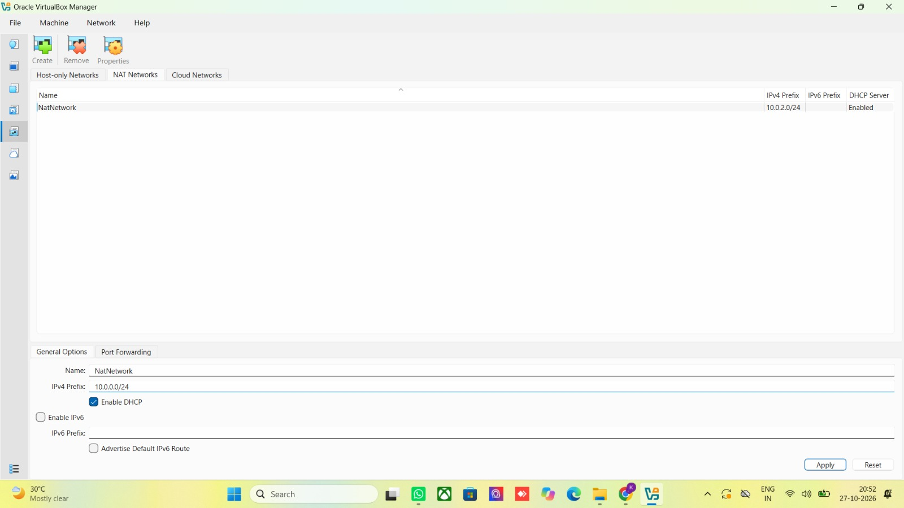
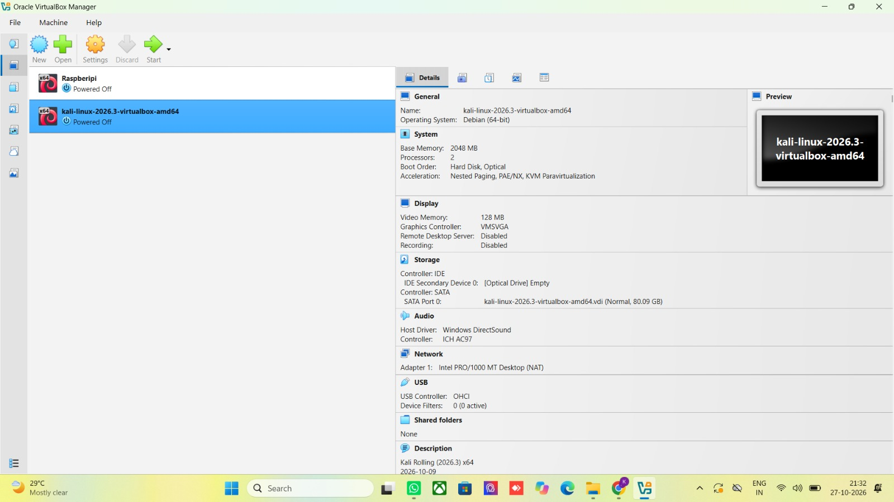
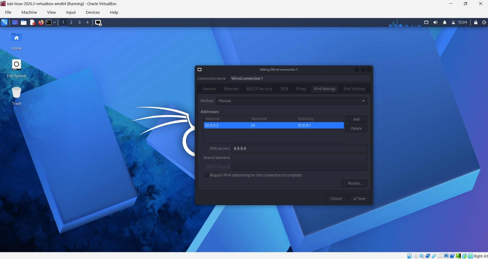
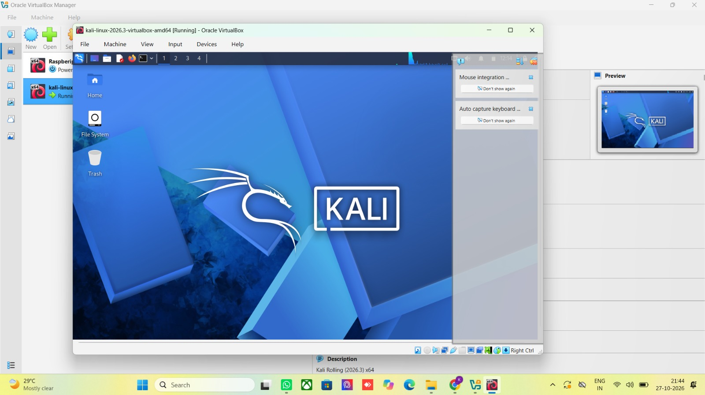
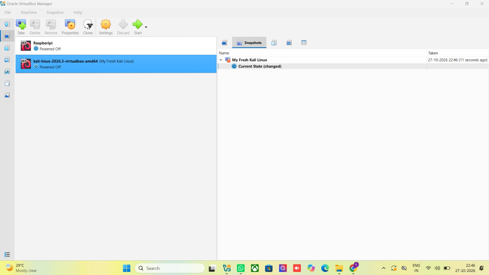
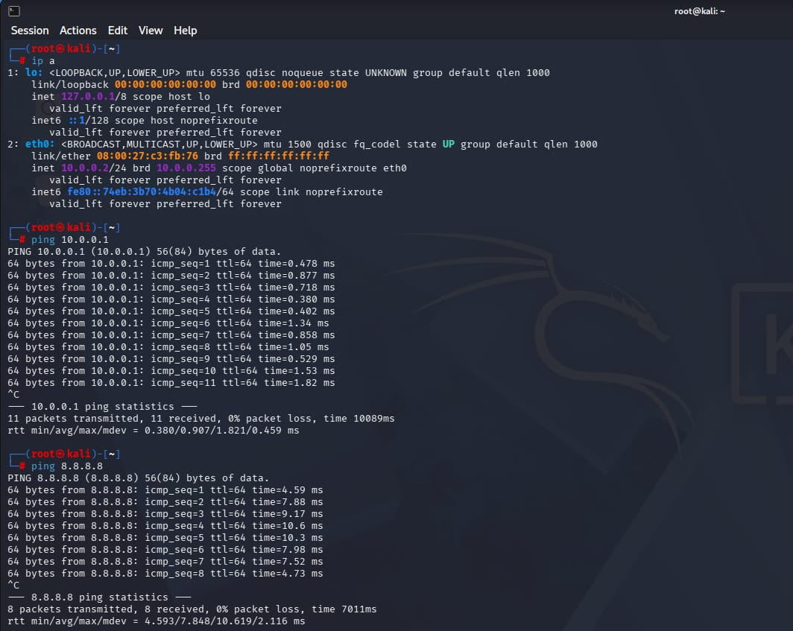
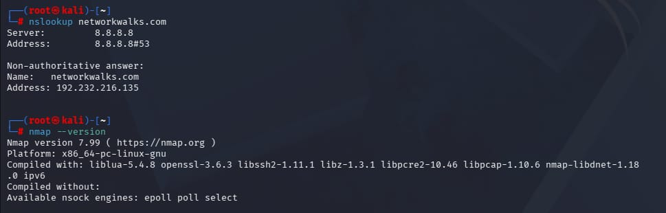
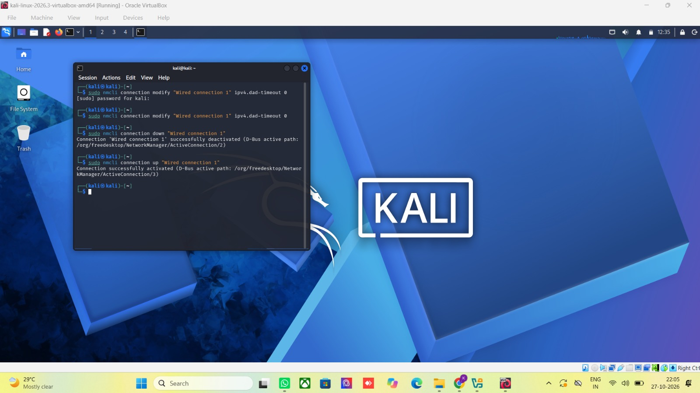

# NETWORKWALKS--KARTHIKEYA-B084-WK1-PM1-CYBERSECURITY-LAB-SETUP

# Cybersecurity Testing Lab Setup (VirtualBox + Kali Linux)

> **Internship Week 1 – Project Module 1 (WK1-PM1)**
> Built by: **Karthikeya Shailesh Kumar** | Date: **27 October 2026**

---

## 📌 Table of Contents
1. [Project Overview](#1-project-overview)
2. [Objectives](#2-objectives)
3. [Lab Architecture](#3-lab-architecture)
4. [Lab Configuration](#4-lab-configuration)
5. [Lab Setup Procedure](#5-lab-setup-procedure)
6. [Lab Verification](#6-lab-verification)
7. [Problems Encountered & Solutions](#7-problems-encountered--solutions)
8. [What I Learned](#8-what-i-learned)
9. [Tools & Resources](#9-tools--resources)

---

## 1. Project Overview

This project documents the setup of an isolated **cybersecurity testing lab** on my personal laptop. The lab uses **Oracle VirtualBox** as the virtualization platform and **Kali Linux** as the attacking (ethical hacker) machine, connected through a custom **NAT Network (10.0.0.0/24)**.

**Purpose of the lab:** to provide a safe, isolated and reusable environment where security tools can be practised legally and without risk to my host machine or any real network. It is the foundation for all upcoming ethical hacking, penetration testing and CTF exercises during the internship, and more virtual machines (Windows 11/10/7, Android, etc.) can be added later on the same network.

---

## 2. Objectives

| # | Requirement | Status |
|---|-------------|--------|
| 1 | Use VirtualBox as the base (latest recommended version) | ✅ Done |
| 2 | Set up Kali Linux as the attacking/hacker machine | ✅ Done |
| 3 | Set up the network in subnet `10.0.0.0/24` | ✅ Done |
| 4 | Use a **NAT Network** with `10.0.0.0/24` | ✅ Done |
| 5 | Enable clipboard & drag/drop in VM settings | ✅ Done |
| 6 | Enable shared folder (host `Downloads` folder) | ✅ Done |
| 7 | Kali Linux IP address must be `10.0.0.2/24` | ✅ Done |
| 8 | Kali Linux must have full Internet access | ✅ Done |
| 9 | Take a snapshot of the VM | ✅ Done |

---

## 3. Lab Architecture

```
┌────────────────────────── Host PC (Windows) ──────────────────────────┐
│                                                                       │
│   ┌──────────────────── Oracle VirtualBox ────────────────────────┐   │
│   │                                                               │   │
│   │   NAT Network: "NatNetwork"  –  10.0.0.0/24  (DHCP enabled)   │   │
│   │   Gateway: 10.0.0.1                                           │   │
│   │        │                                                      │   │
│   │        ├── Kali Linux 2026.3   10.0.0.2/24  (static)          │   │
│   │        └── (future VMs: Windows 11/10/7, Android, CTF VMs)    │   │
│   └───────────────────────────────────────────────────────────────┘   │
│                              │                                        │
└──────────────────────────────┼────────────────────────────────────────┘
                               ▼
                          Internet (via host)
```

| Component | Details |
|-----------|---------|
| Host OS | Windows |
| Hypervisor | Oracle VirtualBox 7.x |
| Attacker VM | Kali Linux Rolling 2026.3 (amd64, pre-built VirtualBox image) |
| Network type | NAT Network (`NatNetwork`) |
| Subnet | `10.0.0.0/24` |
| Gateway | `10.0.0.1` |
| DNS | `8.8.8.8` |
| Kali IP | `10.0.0.2/24` (static) |

---

## 4. Lab Configuration

### 4.1 VirtualBox NAT Network

| Setting | Value |
|---------|-------|
| Name | `NatNetwork` |
| IPv4 Prefix | `10.0.0.0/24` |
| DHCP | Enabled |
| IPv6 | Disabled |



### 4.2 Kali Linux VM Settings

| Setting | Value |
|---------|-------|
| VM name | `kali-linux-2026.3-virtualbox-amd64` |
| Base memory | 2048 MB |
| Processors | 2 |
| Video memory | 128 MB (VMSVGA) |
| Disk | 80.09 GB (`.vdi`) |
| Network – Adapter 1 | Attached to **NAT Network** → `NatNetwork` |
| Adapter type | Intel PRO/1000 MT Desktop (82540EM) |
| Promiscuous mode | Allow All |
| Shared Clipboard | Bidirectional |
| Drag'n'Drop | Bidirectional |
| Shared folder | Host `Downloads` folder (Auto-mount, Full access) |



<!-- TODO: add screenshots of Network (Adapter 1), General > Advanced (clipboard / drag&drop) and Shared Folders pages -->

### 4.3 Kali Linux Static IP (NetworkManager)

| Field | Value |
|-------|-------|
| Method | Manual |
| Address | `10.0.0.2` |
| Netmask | `24` |
| Gateway | `10.0.0.1` |
| DNS servers | `8.8.8.8` |



---

## 5. Lab Setup Procedure

**Step 1 – Install 7-Zip** (needed to extract the Kali image) from <https://7-zip.org/download.html>.

**Step 2 – Install VirtualBox** (latest version) from <https://virtualbox.org/wiki/Downloads>.

**Step 3 – Create the NAT Network**
`File → Tools → Network → NAT Networks → Create`, then set:
Name `NatNetwork`, IPv4 Prefix `10.0.0.0/24`, DHCP enabled → **Apply**.

**Step 4 – Download & import Kali Linux**
1. Download the pre-built **VirtualBox** image from <https://kali.org/get-kali>.
2. Extract it with 7-Zip and add the `.vbox` file to VirtualBox (`Machine → Add`).

**Step 5 – Configure the Kali VM**
1. `Settings → Network → Adapter 1` → Attached to **NAT Network**, Name **NatNetwork**, Promiscuous Mode **Allow All**.
2. `Settings → General → Advanced` → Shared Clipboard **Bidirectional**, Drag'n'Drop **Bidirectional**.
3. `Settings → Shared Folders` → add the host `Downloads` folder (Auto-mount, Full access).

**Step 6 – Boot Kali and set the static IP**
1. Start the VM and log in (default credentials: `kali / kali`).
2. Network icon (top-right) → **Edit Connections** → *Wired connection 1* → **IPv4 Settings**.
3. Method **Manual** → Address `10.0.0.2`, Netmask `24`, Gateway `10.0.0.1`, DNS `8.8.8.8` → **Save**.



**Step 7 – Apply the Internet-connectivity fix** (see [Section 7](#7-problems-encountered--solutions)).

**Step 8 – Take a snapshot** of the clean, working VM: `Machine → Take Snapshot` → name it **"My Fresh Kali Linux"**.



---

## 6. Lab Verification

### 6.1 IP address & network connectivity

Commands used:

```bash
ip a              # confirm the IP address
ping 10.0.0.1     # reach the NAT Network gateway
ping 8.8.8.8      # reach the Internet
```

| Test | Result |
|------|--------|
| `eth0` IP address | `10.0.0.2/24` ✅ |
| Ping gateway `10.0.0.1` | 11 sent / 11 received, **0% packet loss** ✅ |
| Ping Internet `8.8.8.8` | 8 sent / 8 received, **0% packet loss** ✅ |



### 6.2 DNS resolution & tools check

```bash
nslookup networkwalks.com   # confirm DNS works
nmap --version              # confirm Nmap is installed
```

| Test | Result |
|------|--------|
| DNS lookup `networkwalks.com` | Resolved to `192.232.216.135` via `8.8.8.8` ✅ |
| Nmap | Version **7.99** installed ✅ |



---

## 7. Problems Encountered & Solutions

### Problem: Kali VM had no Internet access

**Symptoms:** After assigning the static IP `10.0.0.2/24`, the VM could not reach the Internet.

**Cause:** This is a known issue with VirtualBox 7 and Kali Linux 2026.1 or newer. NetworkManager waits for IPv4 Duplicate Address Detection (DAD) on the virtual adapter, which delays or breaks the connection coming up properly.

**Solution:** Disable the DAD timeout for the connection and restart it:

```bash
sudo nmcli connection modify "Wired connection 1" ipv4.dad-timeout 0
sudo nmcli connection down "Wired connection 1"
sudo nmcli connection up "Wired connection 1"
```



After running these commands the connection came up successfully and the ping tests in [Section 6](#6-lab-verification) passed.

**Other checks from the troubleshooting guide** (see the lab PDF for the full list):
- NAT Network was created correctly (`10.0.0.0/24`).
- All adapter and IP settings were correct.
- No other VM on the same NAT Network uses `10.0.0.2`.
- If it still fails, try DNS `10.0.0.1` instead of `8.8.8.8`, and restart the VMs / host.

📄 Full details: [`WK1-PM1 – Lab Setup VirtualBox and Kali Linux.pdf`](./WK1-PM1_-_Week1_-_Project_Module1_-_Lab_Setup_Virtualbox_and_Kali_Linux_v4_2.pdf)

---

## 8. What I Learned

- How to install and configure **VirtualBox** and import a pre-built VM.
- The difference between **NAT** and **NAT Network** – a NAT Network lets multiple VMs share one subnet and talk to each other while still reaching the Internet.
- How to plan an IP scheme (`10.0.0.0/24`, gateway `10.0.0.1`, Kali at `10.0.0.2`) and configure a **static IP** through NetworkManager.
- How to troubleshoot connectivity in layers: IP config → gateway ping → Internet ping → DNS lookup.
- Using `nmcli` to modify and restart network connections from the terminal.
- Why **snapshots** matter: they give a clean restore point before testing risky tools.
- Why a separate, isolated lab is essential for ethical hacking practice.

---

## 9. Tools & Resources

| Tool | Purpose | Link |
|------|---------|------|
| Oracle VirtualBox | Virtualization platform | <https://virtualbox.org/wiki/Downloads> |
| Kali Linux 2026.3 | Attacking / penetration-testing OS | <https://kali.org/get-kali> |
| 7-Zip | Extracting the Kali image | <https://7-zip.org/download.html> |
| NetworkManager (`nmcli`) | Network configuration | – |
| Nmap 7.99 | Network scanner (installed check) | <https://nmap.org> |
| Networkwalks Academy | Lab guide / task PDF | <https://www.networkwalks.com> |

---

> ⚠️ **Ethical use:** This lab is for learning and authorised testing only. Never use these tools against systems or networks you do not own or have explicit written permission to test.
